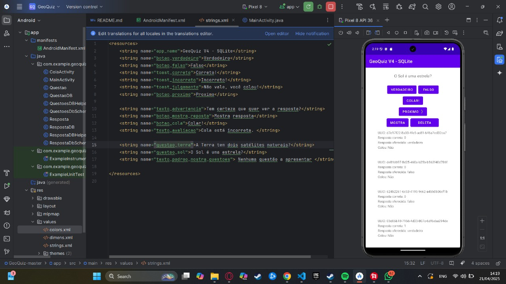
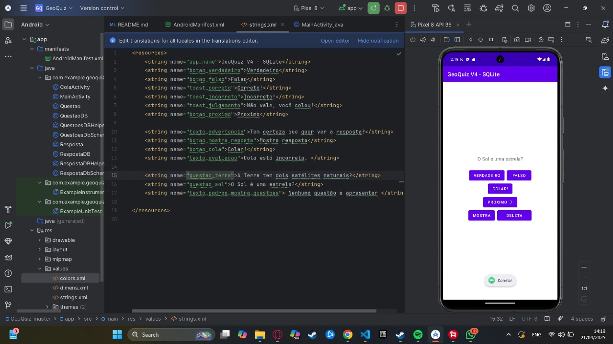

# GeoQuiz

Versão estendida do aplicativo Android **GeoQuiz**, desenvolvida na disciplina de Aplicações Móveis. O app apresenta perguntas de geografia (verdadeiro ou falso) e agora registra e gerencia o histórico de respostas.

## Projeto original

- Autor: Udo Fritzke ([udofritzke/GeoQuiz](https://github.com/udofritzke/GeoQuiz))
- Baseado no exemplo do livro *Android Programming: The Big Nerd Ranch Guide*
- Funcionalidades base: perguntas com resposta verdadeiro ou falso, feedback visual, contador de acertos e navegação entre perguntas

## O que foi alterado

- **Registro automático de respostas:** salva UUID da questão, resposta correta, resposta do usuário e uso de cola
- **Botão `CADASTRA` removido:** a persistência ocorre ao responder
- **Botão `MOSTRA` redefinido:** exibe em tempo real todas as respostas registradas
- **Botão `DELETA` adicionado:** exclui os registros
- Interface simplificada

## Ambiente

| Item | Versão |
|---|---|
| Android Studio | 2024.3.1 Patch 1 (Meerkat) |
| Gradle | 8.6.1 |
| SDK mínimo | 24 |
| API alvo | 33 |
| JDK | OpenJDK 21.0.5 (JetBrains) |

## Demonstração

  

[Vídeo no YouTube](https://youtu.be/j4-MXtRYFH8)

## Histórico de versões

| Versão | Mudanças |
|---|---|
| 4.0.0 | Registro automático, remoção do `CADASTRA`, `MOSTRA` redefinido, inclusão do `DELETA` |
| 3.0.0 | Implementação base, navegação sequencial entre perguntas |

## Autores

Kleberson Crystyan de Lima, Vinicius Fernandes Betti, Vitor Hugo Granato Moreira do Prado e Gabriel Henrique Custódio.
